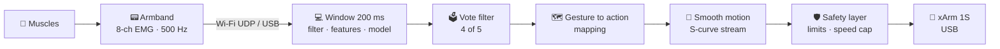

<div align="center">

# 🦾 EMG Robotic Arm

### Control a Hiwonder **xArm 1S** with your muscles: gestures from the **BioWave ESP32-S3 EMG armband**


[Quick start](#-quick-start) ·
[How it works](#-how-it-works) ·
[Documentation](#-documentation) ·
[Project map](#-project-map) ·
[Safety](#-hardware-safety-checklist)

</div>

---

## ✨ What it does

Wear the armband, make a gesture, and the arm follows. The app reads 8 EMG channels at 500 Hz (plus an IMU), classifies each 200 ms window with a trained model, filters the result so a single wrong guess can never move the arm, and streams smooth, speed-limited moves to the robot.

| | |
|---|---|
| 🖐️ **10 gestures** | Left, Right, Up, Down, Closed Fist, Double Closed Fist, Victory, Thumbs Up, Pinch, Rest, each mapped to an action you choose |
| 🧠 **25 trainable models** | classical ML, deep and hybrid networks, benchmarked for accuracy *and* real-time speed ([Model_Training](Model_Training/README.md)) |
| 📡 **Wi-Fi or USB armband** | authenticated UDP stream with automatic recovery, or a wired fallback ([Network](docs/NETWORK.md)) |
| ⌨️ **Keyboard + on-screen control** | hold keys to drive any joint; works with or without the armband |
| 🛡️ **Safety first** | soft limits, speed cap, vote filter, stale-data guard, voltage check, STOP on every page, parks on exit |
| 🧪 **Test-friendly** | the whole control chain runs without hardware (a software copy of the armband firmware is used in tests) |

## 🔄 How it works



Details of every stage: **[Architecture](docs/ARCHITECTURE.md)** · **[Network & connectivity](docs/NETWORK.md)** · **[Machine learning](docs/MACHINE_LEARNING.md)**.

## 🚀 Quick start

```bash
python3 run.py        # macOS / Linux        |   py run.py     # Windows
```

The first run creates a private `.venv` and installs the pinned libraries from `requirements.txt` (a few minutes, needs internet). Later runs start immediately, and the environment updates itself if `requirements.txt` changes. Needs Python 3.11+.

**Your first five minutes**

1. **Gesture model** → *Upload .joblib files…* → pick a model → *Use selected model*.
2. **Armband** → connect over Wi-Fi (first time: *Set up Wi-Fi over USB*), enter the access key, *Connect*.
3. **Arm control** → *Connect arm* (tick *Simulate* if no arm is plugged in): it goes home by itself.
4. Press **ARM**, then move with gestures or the keyboard. **Space / Esc / the red button stops everything.**

> Not sure about safety? Follow the [bring-up stages](#bring-up-one-stage-at-a-time-do-not-skip-stages) before the first real movement.

## 📚 Documentation

| Document | What you will find |
|---|---|
| [docs/ARCHITECTURE.md](docs/ARCHITECTURE.md) | layers, threads, full pathway, control modes, safety layers, storage |
| [docs/NETWORK.md](docs/NETWORK.md) | topology, ports, discovery, authentication, packet format, link states, troubleshooting |
| [docs/MACHINE_LEARNING.md](docs/MACHINE_LEARNING.md) | data formats, preprocessing, 204 features, all 25 models, evaluation, bundle format, results |
| [docs/CHANGES_AND_ARCHITECTURE.md](docs/CHANGES_AND_ARCHITECTURE.md) | engineering history: issues found, what changed, what is *not* verified |
| Folder READMEs | every folder below has its own README |

## 📁 Project map

| Folder | Contents |
|---|---|
| [`src/emg_arm/`](src/emg_arm/README.md) | the application (packages: [`armband`](src/emg_arm/armband/README.md), [`arm`](src/emg_arm/arm/README.md), [`control`](src/emg_arm/control/README.md), [`ml`](src/emg_arm/ml/README.md), [`ui`](src/emg_arm/ui/README.md)) |
| [`Model_Training/`](Model_Training/README.md) | offline training, benchmarking and the Training Studio GUI |
| [`firmware/`](firmware/README.md) | ESP32-S3 armband firmware |
| [`config/`](config/README.md) | arm limits, home pose, gesture map, filter settings |
| [`tools/`](tools/README.md) | hardware check and measurement helpers |
| [`tests/`](tests/README.md) | automated tests (no hardware needed) |
| [`docs/`](docs/README.md) | architecture, network and ML documentation |
| [`recordings/`](recordings/README.md) | raw EMG recordings made in the app |
| [`logs/`](logs/README.md) | control-session logs and the background log |
| [`Proposal/`](Proposal/README.md) | project proposal material |
| `run.py`, `requirements.txt` | launcher and pinned dependencies |

## 🧭 Using the app

### Sections (left sidebar)

| Group | Section | What it is for |
|---|---|---|
| Robotic arm | **Arm control** (opens first) | One page: connect the xArm 1S (or simulate it): it **goes home by itself** after connecting, and one gripper button opens or closes it · *ARM* · control mode (keys + gestures / gestures only / keyboard only), speed, global confidence · live servo positions · the table of on-screen buttons and keyboard shortcuts is tucked under **Show advanced keyboard controls** (the keys work either way; click a key there to re-assign it) |
| EMG & model | **Gesture model** | Pick the trained `.joblib`; shows how each model class is recognised as one of the ten gestures |
| EMG & model | **Armband** | Connect the real armband over Wi-Fi or USB (four cards, *Connection setup*; the live signal is hidden until you press *Show live signal*) |
| EMG & model | **Live monitor** | 8-channel EMG, model output, confidence, stable gesture, transition history |
| EMG & model | **Gesture mapping** | What each of the ten gestures does (see below) |
| Settings | **Settings & data** | Theme, export/import configuration, raw-signal recording, servo calibration (range, rest pose), advanced motion smoothing (hidden until you ask) |

The red **STOP** button (Space / Esc) is on every page and always works.

### Gesture mapping

Ten gestures: Left, Right, Up, Down, Closed Fist, Double Closed Fist, Victory Sign, Thumbs Up, Pinch, Rest.
Each has: enabled, robot action, joint/servo, direction, speed, target position + duration (go-to-position), hold time, optional
long-hold action, confidence threshold, and an optional *model class* (when your model names a gesture differently).

Actions: move a joint while held · go to a fixed position · toggle / open / close gripper · switch Up/Down joint (shoulder ↔ elbow) ·
go home · hold still · nothing. The editor rejects invalid values (unknown servo, speed over the cap, target outside the servo's safe range,
two gestures driving the same joint the same way) and shows live what the gesture will do; the highlighted row is the gesture detected right now.
Mappings are saved per user (`gesture_mapping.json` in the settings folder) and survive restarts; *Reset to defaults*, *Export…* and *Import…* are on the page.
Mappings cannot be saved while the arm is ARMED. **Double Closed Fist → Go home is shipped disabled**; enable it deliberately.

One-shot actions fire **once per gesture**: keep the gesture detected and nothing repeats; relax / change gesture to arm it again. A per-action cooldown (1.5 s) stops flicker re-triggering.

### Keyboard (defaults, all re-assignable under *Show advanced keyboard controls* on Arm control)

| Keys | Action | Keys | Action |
|---|---|---|---|
| ← / A | base left | → / D | base right |
| ↑ | selected joint up | ↓ | selected joint down |
| W / S | shoulder up / down | E / Q | elbow up / down |
| G | toggle gripper | 1 / 2 | Up/Down controls shoulder / elbow |
| **Space / Esc** | **STOP (fixed)** | | |

Hold to move, release to stop, hold several to combine. Keys only move the arm while ARMED and when no text box has focus; Ctrl/Cmd/Alt combinations are ignored.
*Changed from before:* **D** was elbow-down and is now base-right (WASD-style); elbow-down moved to **Q**. Re-assign under *Show advanced keyboard controls* if you prefer the old layout.

## 🧪 Tests

```bash
python -m unittest discover tests
```
Includes a software copy of the firmware (`tests/fake_armband.py`, test-only: the app has no demo mode) that can lose replies and data, reboot and go silent, a USB test over a pseudo-terminal, and a headless run of the real window. Run the emulator on its own with `python tests/fake_armband.py --key <key>`.

## 🩺 Troubleshooting (or press *Connection setup*)

| Symptom | Fix |
|---|---|
| Scan finds nothing | same 2.4 GHz Wi-Fi as the laptop; VPN off; router "client/AP isolation" off; or type the IP |
| "access key does not match" | *Import from secrets.h* with the file you flashed |
| Connected, no data | allow Python in the firewall (Windows: Private networks; macOS: Firewall options) |
| USB port busy | close the Arduino Serial Monitor |
| Port not listed | use the armband's USB port; try another cable (some are charge-only) |
| *SIMULATION ONLY* in the banner | **Simulate the arm** was ticked. Disconnect, untick it, connect again (it is unticked automatically when the xArm is plugged in at start-up) |
| `open failed` when connecting the arm | arm switched off, USB cable is power-only, or another program has the arm open |
| Arm never moves with EMG (the right gesture shows) | confidence is below *Min. confidence*; look at the % in "Model output". If correct gestures sit at 50-60 %, lower it a little or retrain |
| Arm moves when you are relaxed | raise *Min. confidence*, re-record Rest, retrain, keep the electrodes where they were when you recorded |
| "Same gesture too long - relax" | stuck-gesture lockout after 6 s; relax briefly |
| Motion still a bit jerky on the real arm | raise *Lookahead* (Settings & data → advanced motion smoothing) to 160-200 ms; check with `tools/check_arm.py --glide 6` |
| "Model needs catboost/xgboost/lightgbm" | delete the `.venv` folder and start again, or `pip install` the named library into `.venv` |

## 🔒 Hardware safety checklist

1. **Power the arm from its own 7.5 V adapter or charged battery.** USB is only for data.
2. **Keep the arm's reach clear.** Stable table, nothing and no hands within about 40 cm. The person wearing the armband sits **outside** that reach.
3. **Electrical safety for the person wearing the electrodes.** Use the **Wi-Fi** connection, or if you use USB, run the laptop **on battery (charger unplugged)**.
4. **Only one program may control the arm.** Close any other script that uses it (it may move the arm home as soon as it starts).
5. **Know your physical stop.** Space/Esc first. The arm's power switch cuts everything, but the arm then falls: support it with one hand.
6. **Before closing the app, put down anything the gripper holds.** On exit the arm parks at home and opens the gripper.
7. **Don't leave the gripper squeezing an object for long.** A blocked servo heats up; if needed lower `gripper.close` in `config/arm_config.json`.

The arm never loses torque in software (no `servoOff()`): on stop, disarm, disconnect or exit it holds its pose. Voltage is checked every 10 s; below 6.6 V motion stops.

## Bring-up, one stage at a time (do not skip stages)

**Stage 1 - no arm, no armband.** Open **Arm control**, tick **Simulate the arm**, *Connect arm* (the simulated arm homes by itself), switch the control mode to *Keyboard only*, press **ARM** and drive the simulated arm with the keys or the on-screen buttons. Practise Space/Esc.

**Stage 2 - real armband, simulated arm.** On **Gesture model** pick a model trained on the person who wears the armband. On **Armband** connect over Wi-Fi (or USB). Keep **Simulate** ticked and ARM. Do each gesture and check on **Arm control** (Live) / **Live monitor** that the right action appears and that Rest reliably shows HOLD. Raise *Min. confidence* if you see false moves. Models trained on someone else are much weaker.

**Stage 3 - real arm, keyboard only.** Plug in the arm and switch it on, then run the read-only check:

```bash
python3 tools/check_arm.py            # prints voltage + positions, does not move
python3 tools/check_arm.py --nudge 6  # base moves +30 units and back (asks first); also 5 = shoulder, 4 = elbow
python3 tools/check_arm.py --glide 6  # smooth streamed sweep +80 and back: should look like one continuous motion
```

Use the nudges to confirm which way "+" goes; if Left/Right or Up/Down are reversed, flip the sign in `config/arm_config.json` (`gestures.*.direction` or `vertical_joints.*.up_direction`). Then untick **Simulate**, *Connect arm* (it moves slowly to home by itself, so stand clear), mode *Keyboard only*, ARM, and drive each joint to both ends of its range at speed 50. If a limit would let the arm hit the table or itself, tighten it in `config/arm_config.json` and restart.

**Stage 4 - armband and real arm.** Mode *Keys + gestures* (or *Gestures only*), speed 50-100, ARM, small movements first, a finger near the Space bar.

---

<div align="center"><sub>EMG Robotic Arm 2.0.0 · BioWave armband firmware <code>emg-imu-2.x</code> · protocol BWIM v2</sub></div>
