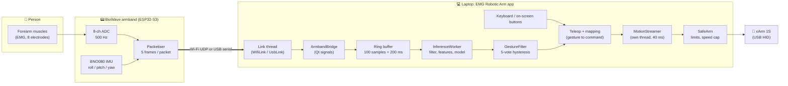
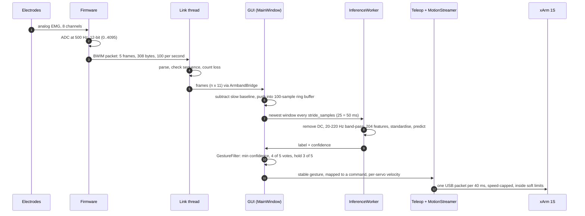

<div align="center">

# 🏗️ System Architecture

**From muscle to motion: every layer, thread and hand-off in the EMG-controlled xArm 1S**

[← Docs index](README.md) · [Network](NETWORK.md) · [Machine learning](MACHINE_LEARNING.md)

</div>

---

## 1. The big picture



Three things the design is built around:

1. **A decision is never made on one sample.** EMG is noise at the single-sample level, so the model always sees a *window* (200 ms) and the arm only reacts after several consecutive agreeing predictions.
2. **The arm is protected by layers that do not trust each other.** The model can be wrong, the filter can be wrong, the user can press the wrong key; the safety layer still clamps every command.
3. **Hardware never blocks the screen.** The network, the model, and the USB writes to the arm each run in their own thread; the GUI only sets *targets*.

---

## 2. Layers

| Layer | Where it lives | What it does | Needs Qt? |
|---|---|---|---|
| **Sensing** | [`firmware/`](../firmware) (ESP32-S3) | Samples 8 EMG channels at 500 Hz and the IMU, batches 5 frames per packet, serves discovery/control, streams UDP or USB | – |
| **Transport** | [`src/emg_arm/armband`](../src/emg_arm/armband) | Wire protocol, authenticated control channel, discovery, links with automatic recovery | no |
| **Signal → gesture** | [`src/emg_arm/ml`](../src/emg_arm/ml) + [`Model_Training`](../Model_Training) | Loads a trained bundle, filters and classifies each window | no |
| **Decision** | [`src/emg_arm/control`](../src/emg_arm/control), [`arm/teleop.py`](../src/emg_arm/arm/teleop.py) | Ten gestures, the gesture→action mapping, vote filter, per-servo velocities | no |
| **Motion** | [`src/emg_arm/arm`](../src/emg_arm/arm) | Smooth S-curve streaming and the safety-guarded xArm driver | no |
| **Interface** | [`src/emg_arm/ui`](../src/emg_arm/ui) | Window, pages, keyboard, STOP button, themes | yes (PyQt5) |
| **Offline training** | [`Model_Training`](../Model_Training) | Builds, compares and exports the gesture models | separate env |

Only `ui/` and `ml/inference.py` (the worker thread) import Qt. Everything else is plain Python, which is why the control chain is unit-tested without hardware.

---

## 3. Threads and timing

| Thread / timer | Rate | Owner | Job |
|---|---|---|---|
| ESP32 core 1 | 500 Hz (2 ms) | firmware | Sample the ADC, queue frames |
| ESP32 core 0 | continuous | firmware | IMU polling, UDP/USB send, control channel |
| Link receive thread | per packet (100/s) | `WifiLink` / `UsbLink` | Read, parse and sequence-check packets |
| Link control thread | every 3 s | `WifiLink` | Keepalive `PING`, recovery, re-discovery |
| GUI thread | event driven | `MainWindow` | Windows, buttons, `on_batch` ring buffer |
| `InferenceWorker` | every 50 ms (newest window only) | `ml/inference.py` | Filter + features + model → label, confidence |
| `control_timer` | 25 ms | `MainWindow.control_tick` | Gesture/keys → velocities |
| `MotionStreamer` | 40 ms | `arm/motion.py` | One packet per tick to the arm, S-curve ramps |
| `ui_timer` | 250 ms | `MainWindow` | Status chips, monitor banner |
| `battery_timer` | 10 s | `MainWindow` | Arm supply voltage check |

> The inference worker keeps **only the newest window**: if the model is slower than the stride, old windows are dropped, never queued. The arm therefore never reacts to stale data.

---

## 4. The full pathway, step by step



### Step details

| # | Step | Detail | Code |
|---|---|---|---|
| 1-2 | **Acquisition** | 8 EMG pins, 500 Hz, 12-bit; IMU rotation vector requested at 200 Hz | [`firmware/…/EMG_IMU_WIFI_SETUP_V2.ino`](../firmware/EMG_IMU_WIFI_SETUP_V2/EMG_IMU_WIFI_SETUP_V2.ino) |
| 3 | **Packetising** | 28-byte header + 5 × 56-byte frames (`BWIM` v2); counters for drops and late frames | [`armband/protocol.py`](../src/emg_arm/armband/protocol.py) |
| 4 | **Receiving** | UDP socket (or COBS+CRC16 over USB), parse, sequence tracking, loss accounting | [`armband/link.py`](../src/emg_arm/armband/link.py) |
| 5 | **Bridging** | Link callbacks become Qt signals (`frames`, `state`, `stats`) | [`ui/bridge.py`](../src/emg_arm/ui/bridge.py) |
| 6 | **Buffering** | Adaptive baseline centring (`0.95·old + 0.05·mean`), sliding ring buffer `(channels × window)` | `MainWindow.on_batch` |
| 7 | **Windowing** | Every `stride_samples` new samples the newest 100-sample window is handed over | `MainWindow.on_batch` |
| 8 | **Preprocess + classify** | See [Machine learning](MACHINE_LEARNING.md#4-the-runtime-path-inside-the-app) | [`ml/inference.py`](../src/emg_arm/ml/inference.py) |
| 9 | **Gesture filter** | Confidence gate → majority vote with hysteresis → stable gesture + hold time | [`arm/teleop.py`](../src/emg_arm/arm/teleop.py) `GestureFilter` |
| 10 | **Mapping** | Stable gesture → action (move joint, go to, gripper, switch joint, home, hold) | [`control/mapping.py`](../src/emg_arm/control/mapping.py), [`commands.py`](../src/emg_arm/control/commands.py) |
| 11 | **Teleop** | Picks the source (gesture or keyboard), applies the speed ramp and reversal guard | `arm/teleop.py` `Teleop` |
| 12 | **Streaming** | S-curve velocity profile, one packet for all moving servos | [`arm/motion.py`](../src/emg_arm/arm/motion.py) |
| 13 | **Safety driver** | Soft limits, speed cap, homing, gripper, voltage, USB access lock | [`arm/driver.py`](../src/emg_arm/arm/driver.py) |

### Latency budget (design estimate)

| Stage | Time |
|---|---|
| Filling one window | 200 ms (the model needs this much signal) |
| Decision interval | 50 ms (stride) |
| Model + preprocessing | ≈ 1-3 ms for most models, ≈ 20-27 ms for Random Forest / Extra Trees |
| Voting | 4 agreeing predictions ≈ 150-200 ms |
| Speed ramp | starts at half speed, full speed after 0.6 s of holding |

So a gesture typically starts moving the arm **a few tenths of a second** after it is performed. These figures come from the configured constants, not from a measurement on the real arm.

---

## 5. Control modes and sources

| Mode | Keyboard | EMG gestures | Use when |
|---|---|---|---|
| **Keys + gestures** (`hybrid`) | overrides gestures | active | normal operation |
| **Gestures only** | ignored (except STOP) | active | hands-free demo |
| **Keyboard only** | active | ignored | testing the arm, no armband |

The arm only moves while **ARMED**. Arming needs: arm connected → homed (this happens automatically after connecting) → ARM pressed.

---

## 6. Safety, layer by layer

| Layer | Guarantee |
|---|---|
| **Gesture filter** | A gesture must reach a minimum confidence and win 4 of the last 5 votes to start; it continues while it keeps 3 of 5. A short misclassification does not restart the speed ramp. |
| **Stale-data guard** | If predictions or EMG data stop for 0.3 s the arm holds still. A link loss clears the stable gesture. |
| **Stuck-gesture lockout** | The same motion for more than 6 s stops until the gesture changes. |
| **Direction-reversal guard** | A short pause before a joint is driven the opposite way. |
| **SafeArm** | Refuses servos without limits, clamps targets to soft limits, stretches durations so no servo exceeds the hard speed cap (300 units/s), serialises USB writes. |
| **MotionStreamer** | Acceleration and jerk limits; slows before a limit; stops by itself if commands stop for 0.25 s. |
| **Voltage monitor** | Checked on connect and every 10 s; below the minimum the arm is stopped. |
| **STOP** | Space / Esc / red button, on every page, at any time (also stops homing and parking). |
| **Torque** | The code never turns servo torque off, so the arm never drops. |
| **Exit** | The arm parks at home and opens the gripper before the app closes. |

---

## 7. Where things are stored

| What | Location | Notes |
|---|---|---|
| App settings (key, last device, theme, uploaded models, calibration) | per-user folder, `settings.json` | macOS `~/Library/Application Support/EMG Robotic Arm/`, never inside the repo |
| Gesture mapping, key assignments | same folder: `gesture_mapping.json`, `keymap.json` | can be exported/imported as one file |
| Arm limits, home pose, filter constants | [`config/arm_config.json`](../config/arm_config.json) | validated on start-up |
| Control-session logs | [`logs/`](../logs) | one CSV per arm connection |
| Background log | `logs/app.log` | support only, not shown in the app |
| Raw EMG recordings | [`recordings/`](../recordings) | from *Settings & data → Record raw signals* |
| Trained models | [`Model_Training/outputs/trained_models/`](../Model_Training/outputs) | uploaded into the app on the *Gesture model* page |

---

## 8. Package map

```
src/emg_arm/
├── app.py · app_log.py · bootstrap.py · paths.py · settings.py · session.py · config_bundle.py
├── armband/   protocol · control · link · netinfo · serial_setup · diagnostics
├── arm/       driver · motion · teleop
├── control/   gestures · mapping · commands
├── ml/        features (legacy) · inference
└── ui/        main_window · bridge · keyboard · theme · widgets · dialogs · tasks · pages/
```

Each folder has its own README with the details.

---

## 9. Design decisions worth knowing

- **One control socket for the whole armband conversation.** The firmware ties a challenge to the sender's *(IP, source port)*; opening a new socket per command made every `START` fail. See [Network](NETWORK.md#4-connecting-and-streaming).
- **Windows are classified at 20 Hz even if a model was trained at 10 Hz.** The app caps the stride at 25 samples so the arm reacts sooner.
- **The model owns its own preprocessing.** A trained bundle carries the filter, features and normalisation, so training and running use identical code (no train/deploy skew).
- **Mapping is data, not code.** What each of the ten gestures does is edited in the UI and stored as JSON; the gesture filter itself never changes.
- **Optional libraries are optional.** A model that needs XGBoost/LightGBM/CatBoost fails with a message naming the library instead of crashing the app.
