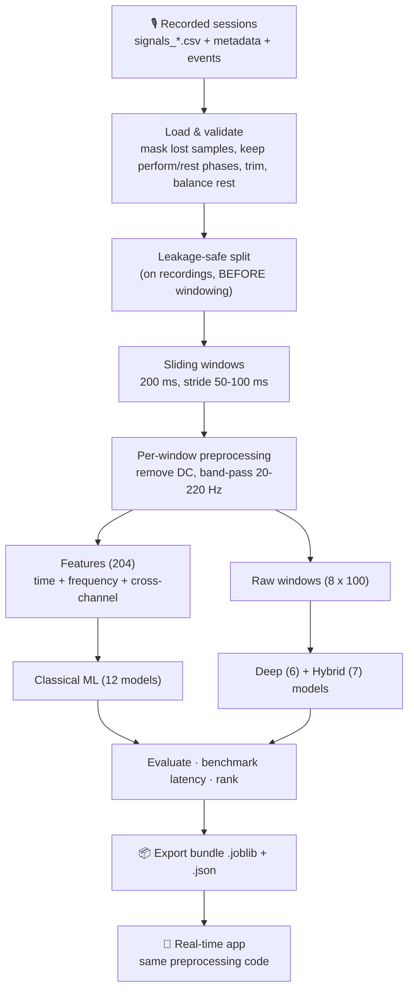

<div align="center">

# 🧠 Machine Learning: Data, Preprocessing, Models

**How raw EMG becomes a gesture label: recording format, windowing, filtering, features, all 25 models, evaluation and deployment**

[← Docs index](README.md) · [Architecture](ARCHITECTURE.md) · [Network](NETWORK.md) · [Model_Training folder](../Model_Training/README.md)

</div>

---

## 1. Overview



The rule that shapes everything: **every operation that touches signal values runs on a window, with the same code in training and in the app.** Statistics (mean, scale, class weights) are fitted on the training split only.

---

## 2. Data

### 2.1 What the armband delivers

8 EMG channels (raw 12-bit ADC counts, 0-4095) at **500 Hz** plus roll/pitch/yaw. **Only the 8 EMG channels are used by the models.** The IMU angles are never model inputs: they are a feature of the *recording session* (arm posture), not of the muscle signal.

### 2.2 Recording formats the loader understands

| Format | Produced by | Contents |
|---|---|---|
| **BioWave session folder** (preferred) | the BioWave recording app | `signals_<id>.csv` (Ch1-Ch8, IMU, `Valid`, `Phase`, `Label`, `Label_Code`, `Hand`, `Trial_ID`…), `events_<id>.csv` (cue log), `metadata_<id>.json/txt` (participant, protocol, channel map, sampling rate), `quality_<id>.json` (loss, gaps, jitter) |
| **Single CSV** | this app: *Settings & data → Record raw signals* | `host_time_s, packet_seq, frame_id, emg1…emg8, roll, pitch, yaw`, label taken from the file name |
| Other tabular | any | `*.csv, *.tsv, *.txt, *.parquet, *.npy` with auto-detected channels |

Single-file labels come from a column (`label`/`gesture`/`class`) or the file name, e.g. `emg_<date>_<time>_S02_sess1_closed_fist_trial3.csv` → subject `S02`, session `sess1`, gesture `closed_fist`.

### 2.3 How a session folder is turned into training data ([`session_io.py`](../Model_Training/session_io.py))

| Rule | Why |
|---|---|
| Channels come from the metadata `channel_map` (type `emg`) | IMU never reaches a model |
| Rows with `Valid == 0` are **masked, not interpolated** | no window may contain lost or NaN samples |
| Only phases `perform` and `rest` get a label (`prepare` cue, `paused`, `switch_hand`, `end` never do) | the cue period is not the gesture |
| Trim: `perform` 0.5 s at the start / 0.25 s at the end; `rest` 1.0 s / 0.25 s | reaction time and relaxation are not the gesture |
| Rest is thinned to **2 × the mean gesture duration** per session | rest is the most frequent state; fix imbalance in the data |
| Sessions with < 90 % valid samples, or < 2 classes, are skipped | quality gate |
| Subject = `participant_id` | left- and right-hand sessions of one person stay on the same side of a subject split |

The ten study gestures: **Left, Right, Up, Down, Closed Fist, Double Closed Fist, Victory Sign, Thumbs Up, Pinch, Rest** (`src/emg_arm/control/gestures.py`).

---

## 3. Preprocessing

### 3.1 Windowing

| Setting | Default | Meaning |
|---|---|---|
| `window_ms` | 200 | 100 samples at 500 Hz |
| `stride_ms` | 50 (CLI) / 100 (training app) | step between windows; also the real-time decision interval (the app asks every 50 ms regardless) |
| Window rule | single label | a window never straddles a label change or a lost sample |

### 3.2 Per-window filtering ([`preprocessing.py: WindowPreprocessor`](../Model_Training/preprocessing.py))

1. **Remove DC** (subtract the window mean).
2. **Band-pass 20-220 Hz**, 4th-order Butterworth (second-order sections), **zero-phase** (`sosfiltfilt`; falls back to causal for tiny windows).
3. **Notch** (50/60 Hz and harmonics): *off by default*; it was measured not to help on dry-electrode data. Available as `notch_hz`.

The filter runs **per window**, never over a whole recording, so training and the live app apply the identical operation.

### 3.3 Features for classical models ([`features.py`](../Model_Training/features.py))

Computed for each of the 8 channels, vectorised over the whole batch:

| Group | Features (per channel) | Count |
|---|---|---|
| **Time domain** | MAV, RMS, variance, IEMG, waveform length, max abs, zero crossings, slope-sign changes, Willison amplitude, skewness, kurtosis, Hjorth mobility, Hjorth complexity | 13 |
| **Frequency domain** (20-220 Hz, Hann window FFT) | mean freq, median freq, peak freq, spectral entropy, log total power | 5 |
| **Band power** (relative) | 20-60 Hz, 60-120 Hz, 120-220 Hz | 3 |
| | **per channel** | **21** → 8 × 21 = **168** |
| **Cross-channel** | RMS of each channel relative to the mean RMS | 8 |
| | pairwise correlation between channels (8·7/2) | 28 |
| | **total** | **204** |

Zero-crossing, slope-sign and Willison thresholds are set **relative to the window's standard deviation** (5 % and 25 %), so the features do not depend on the absolute signal scale.

### 3.4 Normalisation (fitted on the training split only)

- **Feature models:** standardise each of the 204 features (`feat_mean`, `feat_scale`).
- **Deep models:** standardise raw windows per channel (`raw_mean`, `raw_scale`).
- The statistics are stored in the exported bundle, so inference applies exactly the same scaling.

### 3.5 Class imbalance

Rest thinning in the data (§2.3) plus balanced class weights in every model that supports them, and balanced accuracy / macro scores in the evaluation.

---

## 4. The runtime path inside the app

```
armband frames ─▶ subtract slow baseline ─▶ 100-sample ring buffer ─▶ (every 50 ms)
   ─▶ remove DC ─▶ 20-220 Hz band-pass ─▶ 204 features ─▶ standardise ─▶ model ─▶ (label, confidence)
   ─▶ GestureFilter (min confidence, 4 of 5 votes) ─▶ mapping ─▶ arm
```

| Step | Where | Note |
|---|---|---|
| Baseline | `MainWindow.on_batch` | `baseline = 0.95·baseline + 0.05·mean(batch)`; removes slow drift |
| Window | ring buffer | the model's `window_samples` (100) |
| Everything from "remove DC" to "confidence" | `GestureClassifier.predict_window()` inside the bundle | **identical code to training** |
| Stride | `ml/inference.py` | capped at 25 samples (50 ms) even if the model was trained with 100 ms |
| Vote filter | `arm/teleop.py` | confidence ≥ 0.65 (global; per-gesture overrides in *Gesture mapping*), 4 of 5 to start, 3 of 5 to stay |

**Older models:** a joblib containing `model` + `class_names` (from the earlier BioWave pipeline) is still supported; it uses the app's own feature set in [`ml/features.py`](../src/emg_arm/ml/features.py) (70 / 156 / 231 features for 4 / 8 / 11 channels).

---

## 5. All models

### 5.1 Classical ML (input: the 204 features)

| Key | Model | Main settings |
|---|---|---|
| `rf` | Random Forest | 200 trees, √features per split, balanced class weights |
| `extra_trees` | Extra Trees | 200 trees, √features, balanced class weights |
| `xgboost` | XGBoost | 300 trees, lr 0.08, depth 6, subsample/colsample 0.8 |
| `lightgbm` | LightGBM | 300 trees, lr 0.06, 31 leaves, subsample 0.8 |
| `catboost` | CatBoost | 300 iterations, depth 6, lr 0.1, MultiClass loss |
| `svm_rbf` | SVM (RBF) | C = 10, γ = scale (switches to a linear solver above ≈ 10 k windows) |
| `svm_linear` | SVM (linear) | C = 1 |
| `knn` | k-NN | k = 7, distance weighted |
| `logreg` | Logistic Regression | C = 1, up to 1000 iterations |
| `lda` | LDA | `lsqr` solver, automatic shrinkage |
| `gradient_boosting` | Gradient Boosting | 100 trees, lr 0.1, depth 3 |
| `mlp` | MLP | hidden layers (128, 64), α = 1e-3 |

### 5.2 Deep models (input: the raw normalised window, 8 × 100)

| Key | Model |
|---|---|
| `cnn1d` | 1-D CNN |
| `cnn2d` | 2-D CNN (channels × time) |
| `lstm`, `bilstm` | LSTM, bidirectional LSTM |
| `gru` | GRU |
| `transformer` | Transformer encoder |

### 5.3 Hybrid models (shared convolutional front-end → sequence head)

| Key | Model |
|---|---|
| `cnn_lstm`, `cnn_gru`, `cnn_bilstm` | CNN → recurrent head |
| `cnn_tcn` | CNN → temporal convolutional network |
| `cnn_attention` | CNN → attention |
| `cnn_transformer` | CNN → Transformer |
| `cnn_rf` | 1-D CNN trained end-to-end, then frozen; its 64-d embeddings feed a Random Forest that makes the decision |

All networks are defined once in [`models/dl_nets.py`](../Model_Training/models/dl_nets.py). Deep-model training: AdamW (or Adam), lr 2e-3, weight decay 1e-4, batch 128, up to 40 epochs, early stopping (patience 8) on the validation split, dropout 0.3, light noise + gain augmentation, per-model wall-clock cap (600 s in the training app, 900 s in the CLI). They need PyTorch, which is optional.

> Optional libraries (XGBoost, LightGBM, CatBoost, PyTorch) are skipped with a message if missing. **To run such a model in the app, the same library must be installed in the app's `.venv`** (they are pinned in `requirements.txt`).

---

## 6. Fair and leak-free evaluation

Sliding windows overlap by 50-75 %, so a random window split would put near-copies of the same signal into train and test and inflate every score. Instead:

| Split mode | Held out for testing | Use |
|---|---|---|
| `subject` | whole subjects | subject-independent generalisation (needs ≥ 3 subjects) |
| `session` | whole sessions | day-to-day generalisation |
| `recording` | whole recordings | stratified by gesture |
| `trial` | the **later repetitions** of each gesture (earliest = train, middle = validation) | realistic protocol for a *personal* model |
| `temporal` | disjoint time blocks inside each run | optimistic fallback for tiny datasets |
| `auto` | the strictest mode the data allows | default |

Splitting happens on recording segments **before** windowing, and `splits.py` asserts no shared samples or groups. There is deliberately no random-window split. All models see the same windows, split, seed and test set; test data is never used for early stopping, tuning or model choice.

---

## 7. Metrics, benchmark and ranking

| Area | What is measured |
|---|---|
| **Accuracy** | accuracy, balanced accuracy, macro/weighted precision, recall, F1, one-vs-rest macro ROC-AUC, per-gesture P/R/F1, 95 % confidence half-width, per-held-out-group scores |
| **Real-time behaviour** | causal soft-vote smoothing over the last *k* = 5 windows → smoothed accuracy/F1 and decision delay |
| **Speed** | latency of the **whole deployed pipeline** (filter + features + model) per window: mean, median, P95, P99, max; model-only and preprocessing-only; batch latency; throughput; load time |
| **Footprint** | model size on disk, parameters, peak inference memory |
| **Budget** | default budget = the stride. P95 ≤ 25 % of budget → *comfortable*, ≤ 100 % → *marginal*, otherwise *too slow* |
| **Ranking** | best overall, best macro-F1, best generalisation, fastest viable, best real-time, best lightweight, best deep, best hybrid (never accuracy alone) |

---

## 8. Exported model bundle

Each successful model is saved as `<Model>_<run>.joblib` plus a sidecar `<Model>_<run>.json`:

```text
{ "format": "emg_gesture_classifier", "format_version": 1,
  "classifier": GestureClassifier,        # model + preprocessor + feature extractor + normalisation + class names
  "classes": [...],  "metadata": {...} }
```

The sidecar JSON holds the dataset summary, split, window counts per class, settings, metrics (test and validation), real-time numbers, library versions and the path. The app reads it to show **test accuracy** and **training windows per class** when you load the model.

Use it from Python:

```python
from Model_Training.app.inference import load_gesture_classifier
clf = load_gesture_classifier("Model_Training/outputs/trained_models/LDA_20261124_143936.joblib")
label, confidence = clf.predict_window(window)   # window: (samples, channels) raw ADC counts
```

In the desktop app: **Gesture model → Upload .joblib files → Use selected model**.

---

## 9. Results of the latest bundled run (`20261124_143936`)

Data: subject `S05`, one session (`day01`, right hand), 10 classes, 8 channels @ 500 Hz, split `trial` (13 held-out segments), windows train / validation / test = 1589 / 317 / 343, 204 features, window 200 ms, stride 100 ms.

| Model | Test accuracy | Test acc. smoothed (k = 5) | Mean latency / window |
|---|---|---|---|
| CatBoost | 0.869 | 0.886 | 1.0 ms |
| Extra Trees | 0.866 | 0.892 | 21.2 ms |
| LightGBM | 0.863 | 0.895 | 1.9 ms |
| Random Forest | 0.863 | 0.880 | 20.1 ms |
| Gradient Boosting | 0.857 | 0.883 | 1.8 ms |
| XGBoost | 0.857 | 0.878 | 1.5 ms |
| LDA | 0.857 | 0.837 | 1.5 ms |
| SVM (RBF) | 0.854 | 0.860 | 2.9 ms |
| MLP | 0.848 | 0.878 | 1.2 ms |
| SVM (linear) | 0.837 | 0.883 | 2.8 ms |
| Logistic Regression | 0.834 | 0.883 | 1.7 ms |
| k-NN | 0.790 | 0.845 | 2.4 ms |

**How to read this honestly:** one person, one session and 343 test windows give a 95 % interval of about ±5 points, and the models are only tested on *later repetitions of the same session*. Expect lower accuracy after re-fitting the armband or on another day, so record a new session for the person who will wear it. Earlier bundles (`20261123_*`) were trained on individual rows with the label and trial id among the inputs; they are leaky, report 100 % and cannot drive the arm.

---

## 10. Common pitfalls

| Pitfall | Consequence | What this project does |
|---|---|---|
| Random window split | inflated scores | split before windowing, by trial/session/subject |
| Label, trial id, timestamps or phase as features | 100 % accuracy, useless on the arm | models only see the 8 filtered EMG channels |
| Fitting scalers on all data | leakage | fitted on the training split only |
| Training and deployment preprocessing differ | silent accuracy loss | one preprocessor object shipped inside the bundle |
| Electrodes in a different place | accuracy drops | record and train with the armband in the wearing position |
| Too few examples of a gesture | unreliable class | the app shows training windows per class and warns below 50 |
