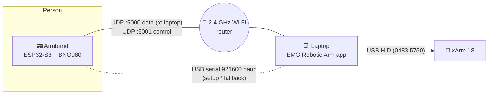
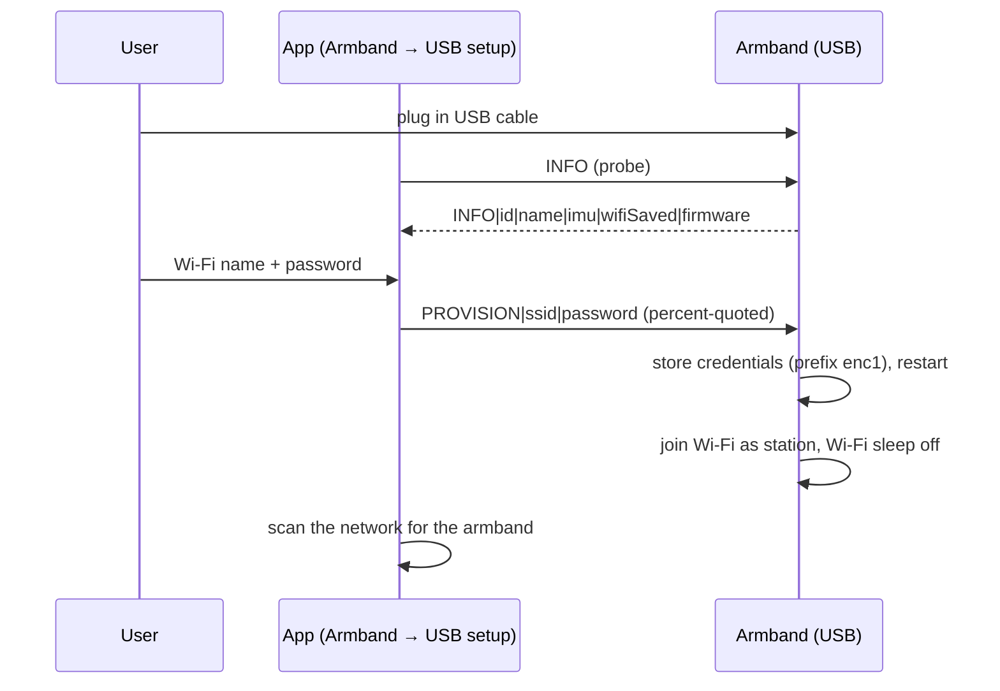
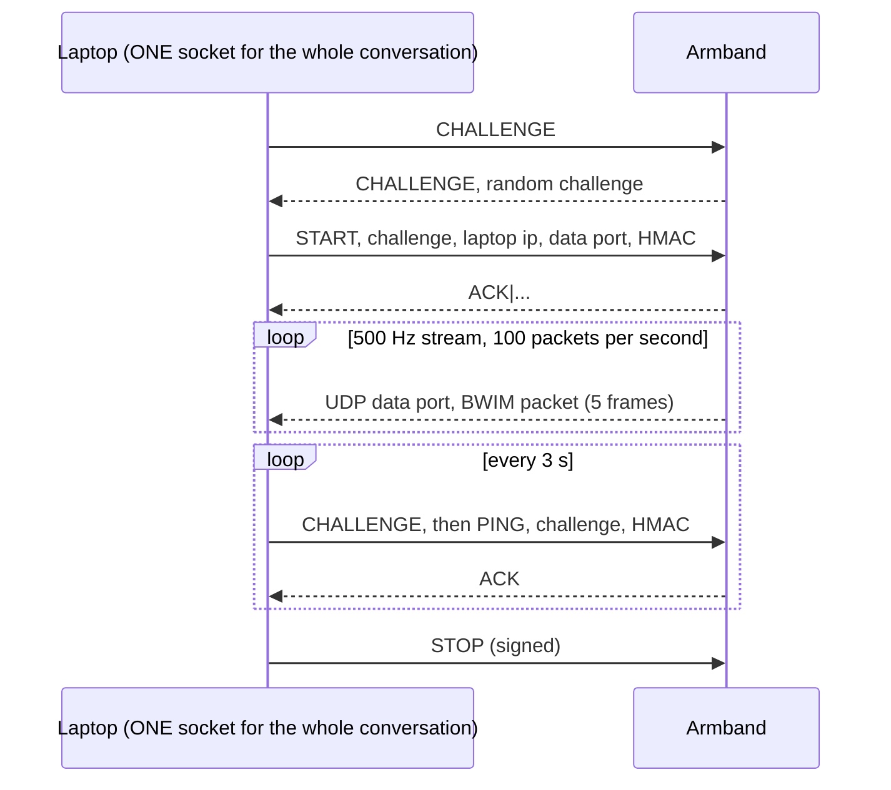

# 📡 Network & Connectivity

**How the laptop finds, authenticates and streams from the armband, and how it talks to the arm**

[← Docs index](README.md) · [Architecture](ARCHITECTURE.md) · [Machine learning](MACHINE_LEARNING.md)

---

## 1. Topology

| Link | Medium | Purpose |
|---|---|---|
| Armband ⇄ laptop (recommended) | Wi-Fi, UDP | Discovery, authenticated control, 500 Hz data stream |
| Armband ⇄ laptop (fallback) | USB serial, 921 600 baud | First-time Wi-Fi setup (`PROVISION`) and wired streaming |
| Laptop → arm | USB (HID, vendor `0x0483`, product `0x5750`) | Servo commands through the `xarm` library; no network involved |

**Why Wi-Fi is recommended:** the person wearing the electrodes is not galvanically connected to the laptop. If you use the USB cable, run the laptop on battery (charger unplugged).

---

## 2. Ports and protocols

| Port | Transport | Direction | Content |
|---|---|---|---|
| **5000** | UDP | armband → laptop | `BWIM` data packets (the laptop binds the first free port from 5000 up to 5009 and tells the armband which one) |
| **5001** | UDP | laptop ⇄ armband | Text control messages: `DISCOVER`, `CHALLENGE`, `START`, `PING`, `STOP`, replies `HELLO`, `ACK`, `ERR` |
| serial | USB CDC, 921 600 baud | both | `INFO`, `PROVISION`, `USBSTART`, `USBPING`, `USBSTOP`, and COBS-framed data |

Requirements on the network: both devices on the **same 2.4 GHz network and subnet**, VPN off, router *client/AP isolation* off, firewall allowing Python on private networks.

---

## 3. First-time setup: giving the armband your Wi-Fi

- Credentials are percent-encoded only where the firmware's decoder needs it (`%`, `|`, `+`, control and non-ASCII characters).
- This is needed **once per Wi-Fi network**; the armband remembers it.
- Code: [`armband/serial_setup.py`](../src/emg_arm/armband/serial_setup.py), dialog in [`ui/dialogs.py`](../src/emg_arm/ui/dialogs.py).

---

## 4. Connecting and streaming

### 4.1 Discovery

[`armband/control.py: discover()`](../src/emg_arm/armband/control.py) sends `DISCOVER` and collects `HELLO|id|name|mode|ip|imu|locked|firmware[|rate]` replies.

1. List the real network interfaces (loopback and virtual adapters last).
2. **Directed broadcast** on each interface, bound to that adapter, repeated.
3. If the router drops broadcasts, **unicast sweep** of the local /24.
4. Result: device id, name, IP, firmware, IMU status. You can also type the IP by hand.

### 4.2 The authenticated handshake

- **HMAC-SHA256** over `COMMAND|challenge[|payload]`, keyed with the **device access key** (the `DEVICE_ACCESS_KEY_VALUE` flashed from `secrets.h`). The key itself never crosses the network.
- A challenge belongs to one sender *(IP, source port)* and is single-use, so the client must keep **one socket** for `CHALLENGE` and the signed command. (An older version opened two sockets and the armband always answered `ERR|AUTH_FAILED`.)
- UDP replies are lost now and then (about one in five on busy Wi-Fi), so every transaction is retried from the start with a fresh challenge (up to 4 attempts) and stale datagrams are discarded first.
- The firmware drops the stream after **15 s** without an authorised command, hence the 3 s keepalive.

### 4.3 Link states

| State | Meaning | What the app does |
|---|---|---|
| `idle` | not connected | – |
| `connecting` | discovery / handshake in progress | – |
| `streaming` | data is flowing | normal operation |
| `stalled` | connected but no data for 1.5 s | restarts the stream |
| `reconnecting` | device lost | backs off, re-discovers by device id (DHCP may have changed the IP), retries |
| `failed` | needs the user (wrong access key, port busy) | shows what to fix; no endless retrying |

While not `streaming`, the gesture filter is cleared so an old prediction can never drive the arm.

### 4.4 Wired alternative

`UsbLink` opens the serial port (921 600 baud), sends `USBSTART`, keeps alive with `USBPING`, and reads **COBS-framed** packets (the same `BWIM` bytes + CRC-16/CCITT, `0x00` terminated). Text replies and boot-log lines are separated from frames automatically.

---

## 5. The data packet (`BWIM` v2)

**Header: 28 bytes, little-endian**

| Field | Type | Meaning |
|---|---|---|
| `magic` | 4 bytes | `"BWIM"` |
| `version` | u8 | `2` (v1, 252 bytes, is still parsed) |
| `count` | u8 | frames in this packet (5) |
| `frame_size` | u16 | 56 |
| `sequence` | u32 | packet counter; gaps = lost packets |
| `queue_drops` | u32 | cumulative, frames dropped inside the armband |
| `acq_overruns` | u32 | cumulative, ADC samples taken late |
| `send_failures` | u32 | cumulative, failed UDP sends |
| `wifi_reconnects` | u16 | cumulative |
| `flags` | u16 | reserved |

**Frame: 56 bytes** (× 5)

| Field | Type | Meaning |
|---|---|---|
| `frame_id` | u32 | sample counter |
| `ts_us` | u64 | device timestamp (µs) |
| `imu_id`, `imu_ts_us` | u32, u64 | IMU sample id and time |
| `emg[8]` | u16 × 8 | raw ADC counts, 0-4095 |
| `rpy[3]` | f32 × 3 | roll, pitch, yaw (degrees) |
| `imu_fresh` | u8 | 1 if the IMU value is new |
| `flags` | u8 | bit 0 = frame sampled late |
| `reserved` | u16 | – |

**Total = 28 + 5 × 56 = 308 bytes per packet, 100 packets/s ≈ 31 kB/s (about 250 kbit/s).** The app only uses the 8 EMG channels for gestures; the IMU angles are recorded but never fed to the models.

---

## 6. Health numbers shown in the app

| Number | Meaning | Healthy |
|---|---|---|
| frames / second | received sample rate | ≈ 500 |
| packets lost | gaps in the sequence counter | < 1 % |
| since last data | age of the newest packet | < 0.5 s |

(Detailed counters such as queue drops, late samples, send failures and Wi-Fi reconnects are carried in every packet and available to the code in `LinkStats`.)

---

## 7. Troubleshooting

| Symptom | Likely cause | Fix |
|---|---|---|
| Scan finds nothing | different network, VPN, AP isolation, 5 GHz network | same 2.4 GHz Wi-Fi, VPN off, isolation off, or type the IP |
| `access key does not match` | key in the app ≠ key flashed | *Import from secrets.h* |
| Connected but no data | firewall blocks UDP | allow Python on private networks |
| Frames/s well under 500 | weak Wi-Fi | move closer, reduce other traffic, or use USB (on battery power) |
| Link keeps reconnecting | armband DHCP address changed | the app re-discovers by device id automatically; check router lease time |
| USB port busy | Serial Monitor open | close it |
| `open failed` for the arm | arm off, charge-only cable, another program holds the arm | power on, change cable, close the other program |

The **Connection setup** button on the Armband page runs these checks for you, one at a time ([`armband/diagnostics.py`](../src/emg_arm/armband/diagnostics.py)).

---

## 8. Code map

| Concern | File |
|---|---|
| Packet / message formats, HMAC, COBS, CRC | [`armband/protocol.py`](../src/emg_arm/armband/protocol.py) |
| Discovery and the authenticated control client | [`armband/control.py`](../src/emg_arm/armband/control.py) |
| Wi-Fi and USB links, states, recovery, statistics | [`armband/link.py`](../src/emg_arm/armband/link.py) |
| Interfaces, subnets, VPN detection | [`armband/netinfo.py`](../src/emg_arm/armband/netinfo.py) |
| USB provisioning | [`armband/serial_setup.py`](../src/emg_arm/armband/serial_setup.py) |
| Step-by-step connection checks | [`armband/diagnostics.py`](../src/emg_arm/armband/diagnostics.py) |
| Firmware side | [`firmware/`](../firmware) |
| A software copy of the firmware for tests | [`tests/fake_armband.py`](../tests/fake_armband.py) |

---

## 9. Appendix: what was fixed for the new firmware

| Problem | Fix |
|---|---|
| App only understood BWIM v1 (252 B); firmware sends **v2** (308 B, 28-byte header, 64-bit timestamps, health counters) | `armband/protocol.py` parses v2 (and still v1) and reports sequence gaps, late samples and the firmware's own drop/overrun counters |
| `START` always failed with `AUTH_FAILED`: the firmware ties a challenge to the sender's **IP + source port**, the old app used a new socket per message | `ControlClient` keeps one socket for CHALLENGE + command |
| `HELLO` (9 fields) / `INFO` (7 fields) rejected | tolerant parsers |
| Lost UDP replies | every transaction retried with a fresh challenge, stale datagrams dropped |
| Discovery guessed broadcast addresses (wrong on macOS/Windows, one adapter only) | enumerates real adapters with netmasks, directed broadcast per adapter, 3 rounds, unicast /24 sweep fallback |
| Data port 5000 busy / stolen by another copy (`SO_REUSEADDR`) | exclusive bind, falls back to 5001-5009, tells the armband the port |
| Armband reboot, Wi-Fi drop, DHCP address change, firmware keepalive (15 s) timeout | keepalive every 3 s, watchdog, automatic re-`START`, re-discovery by device ID, exponential back-off |
| Silent "connected but no data" (firewall/VPN) | detected and explained (Windows Defender / macOS firewall / client isolation) |
| USB: opening the port reset the ESP32; fixed 3.5 s sleep; long passwords overflowed the firmware's 255-byte line | DTR/RTS held low, probe retries until the board answers, minimal encoding + length checks |
| USB streaming (CSV text) | COBS + CRC-16 binary framing, resynchronises after corruption |
| Placeholder access key accepted | key validated (≥16 chars, not the placeholder), stored per user outside the repo |
