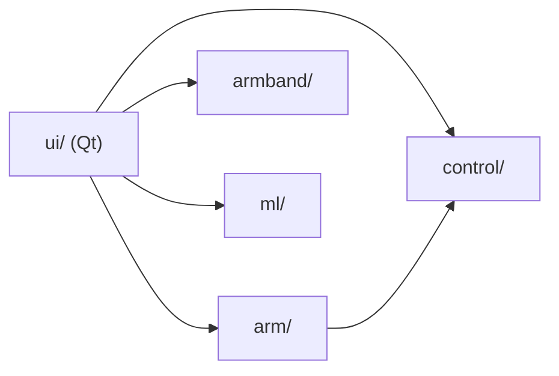

# 🧩 `emg_arm` package

**Armband link → gesture recognition → decision logic → safe arm motion → desktop UI**

[↑ src](../README.md) · [Architecture](../../docs/ARCHITECTURE.md)

## Sub-packages

| Package | Responsibility | Qt? | README |
|---|---|---|---|
| [`armband/`](armband/README.md) | wire protocol, discovery, authenticated control, Wi-Fi and USB links, USB provisioning, connection checks | no | ✔ |
| [`arm/`](arm/README.md) | safety-guarded xArm driver, smooth motion streamer, gesture filter and teleoperation | no | ✔ |
| [`control/`](control/README.md) | the ten gestures, the gesture → action mapping store, command generation | no | ✔ |
| [`ml/`](ml/README.md) | loading trained model bundles, inference worker thread, legacy feature set | worker only | ✔ |
| [`ui/`](ui/README.md) | main window, pages, keyboard, theme, dialogs | yes | ✔ |

## Top-level modules

| File | Purpose |
|---|---|
| `app.py` | entry point: Qt application, settings, theme, main window, signal handling, crash safety net |
| `bootstrap.py` | "clone and run": creates `.venv`, installs `requirements.txt`, relaunches inside it (hash-checked) |
| `paths.py` | where things live (config, logs, recordings, per-user settings folder) |
| `settings.py` | small per-user JSON settings (access key, last device, theme, uploaded models, calibration) |
| `config_bundle.py` | export / import of mapping + keys + tuning + calibration as one validated JSON file |
| `session.py` | `SessionLog` (control events CSV) and `RawRecorder` (raw EMG/IMU CSV) |
| `app_log.py` | quiet background log file (`logs/app.log`), never shown in the window |
| `__init__.py` | `__version__` |

## Dependency rule

`armband/`, `arm/` and `control/` never import Qt, so the full decision chain is unit-tested without a screen or hardware.
