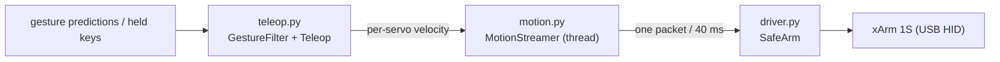

# 🦾 `arm/`

**Safe, smooth control of the Hiwonder xArm 1S**

[↑ emg_arm](../README.md) · [Architecture](../../../docs/ARCHITECTURE.md) · [`config/arm_config.json`](../../../config/README.md)

Pure Python (no Qt). Three modules, three jobs:

## `driver.py`: SafeArm

Every servo command passes `SafeArm._send()`, which:

- refuses servos that have no configured limits;
- **clamps** the target into the soft limits;
- converts to a plain `int` (the xarm library treats floats as degrees and skips its range check for numpy ints);
- **stretches the move duration** so no servo exceeds the hard speed cap (300 units/s);
- serialises USB access with a lock, spaced at least 30 ms apart (the controller only executes the *last* of several back-to-back commands, so multi-servo moves go out as one packet).

Also: homing (≥ 3 s, slow), gripper open/close, `move_to`, `freeze()` (stop where the arm physically is, used when homing/parking is stopped), supply-voltage check, `home_errors()` after parking, a `SimulatedBackend` for use without hardware, and the real `XArmBackend`. **`servoOff()` is never called**: it would cut torque and the arm would fall.

## `motion.py`: MotionStreamer

The servos take "go to P within T ms" and each new command restarts the move, so tiny GUI-timer steps stutter. Instead a dedicated thread:

- takes a target **velocity** per joint from the GUI;
- every 40 ms sends **one** packet for all moving joints, each aimed 120 ms ahead;
- shapes velocity with an **S-curve** (limited acceleration and jerk): no kick at start, stop or reversal;
- slows down before a soft limit instead of stopping dead;
- **anti-jitter:** minimum commanded speed and minimum lead so integer rounding stays a small fraction of the step; packet duration is matched to the rounded lead;
- stops by itself if commands stop for 0.25 s;
- accepts live tuning (`apply_tuning`) from *Settings & data → advanced motion smoothing*, refusing unsafe values.

## `teleop.py`: GestureFilter + Teleop

`GestureFilter` turns noisy predictions into a **stable gesture**:

| Rule | Default |
|---|---|
| confidence gate | ≥ 0.65 (per-gesture overrides possible) |
| to start | wins 4 of the last 5 votes |
| to continue | keeps 3 of 5 (hysteresis) |
| flicker grace | a miss shorter than 0.3 s keeps the speed ramp |
| stale guard | no prediction for 0.3 s → hold still |
| lockout | same motion > 6 s → stops until the gesture changes |

`Teleop` picks the motion source for each 25 ms tick (gestures, keys, on-screen buttons; modes *hybrid*, *gestures*, *keyboard*), applies the speed ramp (start at 50 %, full speed after 0.6 s), a short **direction-reversal guard**, and hands per-servo velocities to the streamer. One-shot actions (gripper, switch joint, go to, home) come from [`control/`](../control/README.md).

## Configuration

All limits, the home pose, speeds, smoothing and filter constants live in [`config/arm_config.json`](../../../config/arm_config.json) and are validated at start-up (for example a home pose outside the limits is refused).
