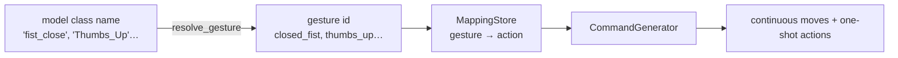

# 🗺️ `control/`

**What each gesture means: ten gestures, one mapping, one command generator**

[↑ emg_arm](../README.md) · [Architecture](../../../docs/ARCHITECTURE.md)

Pure Python (no Qt, no robot access), so it is fully unit-tested.

| Module | Role |
|---|---|
| [`gestures.py`](gestures.py) | the ten study gestures and `resolve_gesture()`, which matches a model's own class names (by words, optional per-model overrides) to the stable gesture ids |
| [`mapping.py`](mapping.py) | `GestureMapping`, defaults derived from the arm config, validation, persistence (`gesture_mapping.json`), per-gesture confidence override |
| [`commands.py`](commands.py) | `CommandGenerator`: reads the stable gesture, looks it up, returns *what should happen*; one-shot actions fire **once per gesture** with a 1.5 s cooldown |

## The ten gestures

`left` · `right` · `up` · `down` · `closed_fist` · `double_fist` · `victory` · `thumbs_up` · `pinch` · `rest`

## Actions

| Action | Kind | Effect |
|---|---|---|
| `move_servo` | continuous | move a joint while the gesture is held |
| `move_to` | one-shot | go to a fixed position over a set time |
| `gripper_toggle` / `gripper_open` / `gripper_close` | one-shot | gripper |
| `switch_joint` | one-shot | Up/Down control shoulder ↔ elbow |
| `go_home` | one-shot | slow move to the home pose |
| `hold` | stop | hold still (used by Rest) |
| `none` | – | do nothing |

An optional **long-hold action** can fire when the gesture is held longer.

## Default mapping

| Gesture | Action |
|---|---|
| Left / Right | move the base while held |
| Up / Down | move the selected joint (shoulder or elbow) while held |
| Closed Fist | hold 0.6 s → toggle gripper; hold 1.8 s → switch joint |
| Double Closed Fist | go home (**disabled by default**) |
| Victory Sign | open gripper |
| Pinch | close gripper |
| Thumbs Up | switch joint |
| Rest | hold still |

## Validation (the editor refuses these)

unknown servo · speed above the cap · target outside a servo's safe range · two gestures driving the same joint the same way · more than one `switch_joint` · a gripper moved as a joint · a long-hold shorter than the hold time. Mappings cannot be saved while the arm is ARMED.
