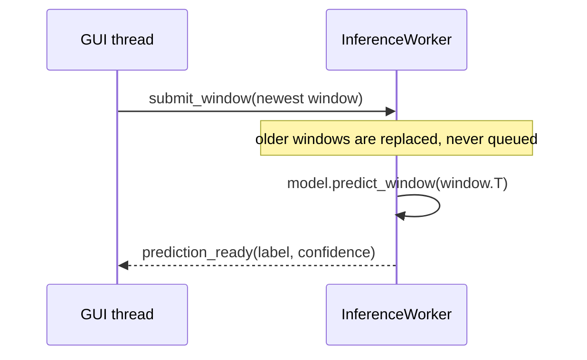

# 🧠 `ml/`

**Running a trained gesture model inside the app**

[↑ emg_arm](../README.md) · [Machine learning](../../../docs/MACHINE_LEARNING.md) · [Model_Training](../../../Model_Training/README.md)

| Module | Role |
|---|---|
| [`inference.py`](inference.py) | `load_model()` reads a `.joblib`; `InferenceWorker` (a `QThread`) classifies the newest window; friendly errors |
| [`features.py`](features.py) | the older, app-side feature set for legacy models (70 / 156 / 231 features for 4 / 8 / 11 channels) |

## Two model formats

| Format | Detected by | Who does the preprocessing |
|---|---|---|
| **Gesture bundle** (current) | `format == "emg_gesture_classifier"` | the bundle itself: DC removal, 20-220 Hz band-pass, 204 features, normalisation, then predict |
| **Legacy** | dict with `model` + `class_names` | this folder's `features.py` |

Table-data models (one row per sample, no EMG windows) are refused with an explanation: they cannot drive the arm.

## The worker thread

- Windows are submitted every `stride_samples`, **capped at 25 samples (50 ms)**, even for models trained with a 100 ms stride.
- If a model is slower than the stride, windows are skipped, so the arm never reacts to stale data.
- A model whose library is missing (XGBoost, LightGBM, CatBoost, PyTorch) fails with a message naming the library and the `pip install` command.
- The sidecar `<model>.json` (when present) supplies the **test accuracy** and **training windows per class** shown on the *Gesture model* page.

## What the model needs from the app

A window of `(window_samples, n_channels)` raw ADC counts. The app subtracts a slow baseline first (`0.95·old + 0.05·mean`); the model removes DC again inside the window.
